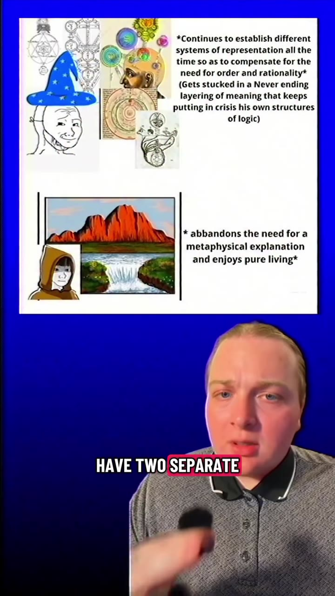
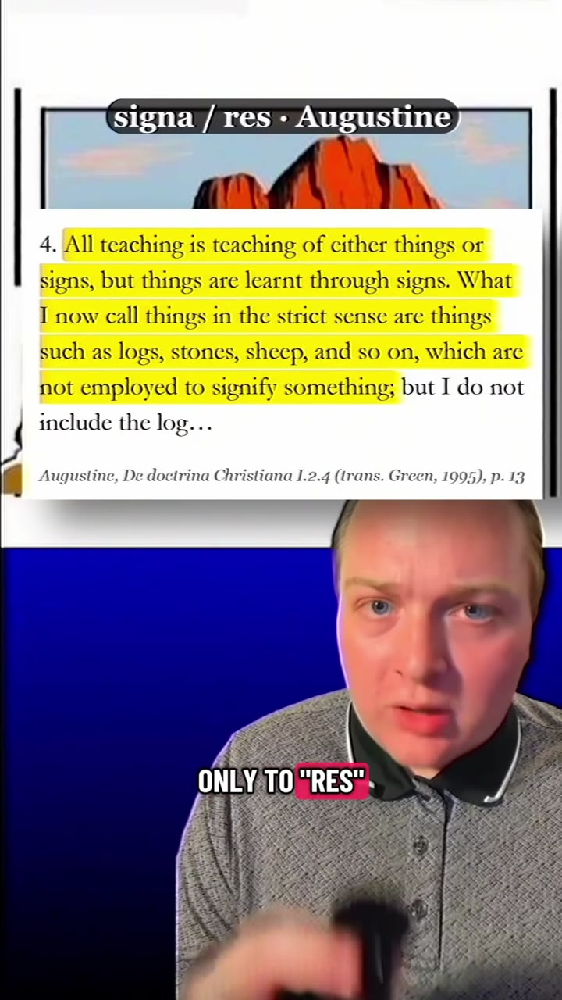
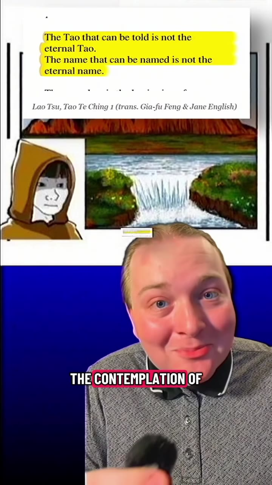
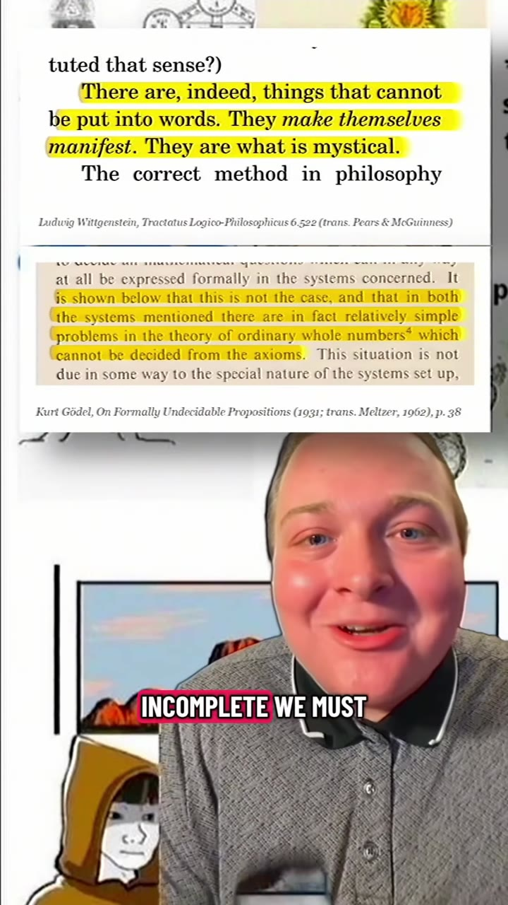

# Signs and things

Source: [original post](https://www.instagram.com/p/DfAzbT-SpDe/) (Instagram video, @misteramazingyt, about 99 seconds).

**Provenance.** Shotaro sent the bare link on 2026-10-28. Recorded here: the caption, the burned-in subtitles and the highlighted book quotations shown on screen (read from sampled video frames). The speech itself could not be transcribed, so the video's argument is not summarised and nothing below is attributed to the speaker beyond the caption and what is on screen.

**Caption (verbatim).** "Of signs and things, and their confusion. Which seems to speak to you more, the significant expression of the thing or the thing itself? If Boehme and Spinoza are right, all things bear the express signature of the Absolute. If Marx is right, that Absolute is none but \"atoms and void\" following Democritus and Epicurus." Tags: #philosophy #mysticism #theology #history #culture

**On-screen text.** A recurring card reads: "Continues to establish different systems of representation all the time so as to compensate for the need for order and rationality (Gets stuck in a never ending layering of meaning that keeps putting in crisis his own structures of logic)" versus "abandons the need for a metaphysical explanation and enjoys pure living". A "signa / res - Augustine" label introduces the sign/thing distinction. Also shown: an engraving of a flea (Hooke-style, "Philosophiae Naturalis" page), a medieval manuscript portrait, a mandala, and a campfire photo for smoke-signifies-fire.

**Subtitle fragments caught in sampled frames (about 1 in 4 seconds, so incomplete, not a transcript):** "ways of apprehending", "negative apprehensions", "only to res", "exoteric although they", "science or arguably", "things themselves", "inner life", "Gendlin says their inner", "the contemplation of", "some eastern woo", "move into what", "or the negative way", "his absence of names", "the ungrund", "vulgar interpretations", "incomplete we must", "the world rather", "language truly is", "draw the line? signs", "clearly the smoke", "of meaning". These fit the arc: signs versus things, mystic and negative-way texts, then incompleteness and the endless play of meaning.

The reel is a reading list: Augustine's signs and things, apophatic and mystical texts (Tao Te Ching, Dionysius, Bonaventure, Boehme), Wittgenstein and Godel on the limits of saying and proof, and Derrida on endless play of signification.

## Items

#### 276. Augustine, De doctrina Christiana

Signs and things (signa / res). On screen: I.2.4 (trans. Green, 1995, p. 13), 'All teaching is teaching of either things or signs, but things are learnt through signs', with logs, stones and sheep as things not used to signify; and II.1.2, natural signs such as smoke signifying fire (a photo of a campfire is shown).

- [Amazon Japan: On Christian Teaching, trans. R. P. H. Green (Oxford World's Classics)](https://www.amazon.co.jp/dp/0199540632)
- [OUP Japan product page](https://www.oupjapan.co.jp/ja/products/detail/5894)

_Edition note: links are to the editions named, which may differ from the edition shown on screen unless stated._

#### 277. Lao Tzu, Tao Te Ching

On screen: chapter 1 (trans. Gia-fu Feng & Jane English), 'The Tao that can be told is not the eternal Tao. The name that can be named is not the eternal name.' Used for the 'eternal name' / unnamable point.

- [Amazon Japan: Tao Te Ching, Gia-fu Feng & Jane English (Vintage)](https://www.amazon.co.jp/dp/039471833X)

_Edition note: links are to the editions named, which may differ from the edition shown on screen unless stated._

#### 278. The Buddha, Satipatthana Sutta (Majjhima Nikaya 10)

On screen: MN 10.3 (trans. Nanamoli & Bodhi, 1995), contemplating mind as mind, fully aware and mindful, putting away covetousness and grief for the world. Caption lists it as further reading only.

- [Access to Insight: Satipatthana Sutta (Nyanasatta Thera translation, not Nanamoli/Bodhi)](https://accesstoinsight.org/tipitaka/mn/mn.010.nysa.html)
- [SuttaCentral MN 10 (Sujato translation)](https://suttacentral.net/mn10/en/sujato)

_Edition note: links are to the editions named, which may differ from the edition shown on screen unless stated._

#### 279. Confucius, Analects

Named in the caption's reading list only. No passage is shown on screen.

- [Chinese Text Project: The Analects (Legge translation, free)](https://ctext.org/analects/ens)
- [Project Gutenberg: The Analects (Legge)](https://www.gutenberg.org/ebooks/3330)

_Edition note: links are to the editions named, which may differ from the edition shown on screen unless stated._

#### 280. Eugene Gendlin, Focusing

On screen: ch. 2 (1978), the 'felt sense' as the body's sense of a particular problem or situation, usually unclear and not yet formed. A photo of Gendlin is shown.

- [Amazon Japan: Focusing, Gendlin (Bantam)](https://www.amazon.co.jp/dp/0553278339)
- [Penguin Random House page](https://www.penguinrandomhouse.com/books/59035/focusing-by-eugene-tgendlin-phd/)
- [Open Library (borrowable)](https://openlibrary.org/works/OL2682851W/Focusing?edition=focusing00gend)

_Edition note: links are to the editions named, which may differ from the edition shown on screen unless stated._

#### 281. Pseudo-Dionysius the Areopagite, The Mystical Theology

On screen: I.1 (trans. Parker, 1897), the mysteries of theology hidden in the superluminous darkness of silence. The via negativa (negative way) point.

- [CCEL: Dionysius the Areopagite, Works (trans. Parker, 1897), Mystic Theology (free, the translation shown on screen)](https://ccel.org/ccel/dionysius/works/works.i.iii.html)

_Edition note: links are to the editions named, which may differ from the edition shown on screen unless stated._

#### 282. Bonaventure, The Soul's Journey into God (Itinerarium mentis in Deum)

On screen: 7.5 (trans. Cousins, 1978), the passage quoting Dionysius on the superluminous darkness. Shown after a mandala-style image and a Bernini-like sculpture.

- [Amazon Japan: Bonaventure: The Soul's Journey into God, The Tree of Life, The Life of St. Francis (trans. Ewert Cousins, Classics of Western Spirituality)](https://www.amazon.co.jp/dp/0809121212)
- [Paulist Press page](https://www.paulistpress.com/Products/2121-2/bonaventure.aspx)

_Edition note: links are to the editions named, which may differ from the edition shown on screen unless stated._

#### 283. Jakob Bohme, Six Theosophic Points

On screen: 1.8 (trans. Earle, 1920), the 'Ungrund' of nature as a mirror, 'a figure of life and of the image belonging to life'. Ties to the caption's claim that all things bear the signature of the Absolute.

- [Internet Archive: Six Theosophic Points and Other Writings (trans. John R. Earle, 1920, free; the translation shown on screen)](https://archive.org/details/sixtheosophicpoi00bh)

_Edition note: links are to the editions named, which may differ from the edition shown on screen unless stated._

#### 284. Ludwig Wittgenstein, Tractatus Logico-Philosophicus

On screen: proposition 6.522 (trans. Pears & McGuinness), 'There are, indeed, things that cannot be put into words. They make themselves manifest. They are what is mystical.'

- [Amazon Japan: Tractatus Logico-Philosophicus (Routledge Classics, Pears & McGuinness translation shown on screen)](https://www.amazon.co.jp/dp/0415255627)
- [Project Gutenberg #5740 (free, but the older Ogden translation, wording differs)](https://www.gutenberg.org/ebooks/5740)

_Edition note: links are to the editions named, which may differ from the edition shown on screen unless stated._

#### 285. Kurt Godel, On Formally Undecidable Propositions of Principia Mathematica and Related Systems

On screen: p. 38 (trans. Meltzer, 1962), the passage on simple problems in the theory of whole numbers that cannot be decided from the axioms. Used for 'if systems are incomplete'.

- [Amazon Japan: On Formally Undecidable Propositions (Dover, trans. B. Meltzer, 1962)](https://www.amazon.co.jp/dp/0486669807)
- [Dover store page](https://store.doverpublications.com/products/9780486669809)

_Edition note: links are to the editions named, which may differ from the edition shown on screen unless stated._

#### 286. Jacques Derrida, Structure, Sign and Play in the Discourse of the Human Sciences (Writing and Difference)

On screen: p. 280 (1966), the transcendental signified never absolutely present outside a system of differences, so the 'play of signification' extends infinitely. This is the 'never-ending layering of meaning' in the on-screen text.

- [Amazon Japan: Writing and Difference (Routledge Classics)](https://www.amazon.co.jp/dp/0415255376)
- [University of Chicago Press page (trans. Alan Bass)](https://press.uchicago.edu/ucp/books/book/chicago/W/bo27619783.html)

_Edition note: links are to the editions named, which may differ from the edition shown on screen unless stated._
