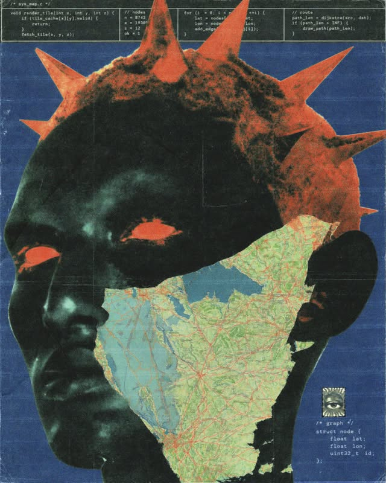
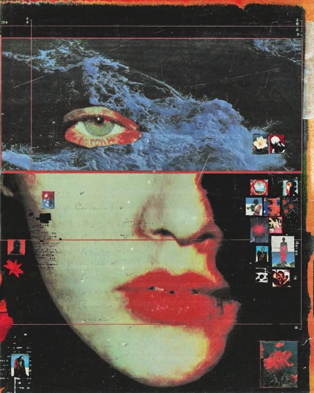

# "wired cuts": two glitch collages by Anton Elfilter

Source: [original post](https://www.instagram.com/p/DfuqPDrjItX/) (Instagram image carousel, 2 slides, @elfilter_a, posted 2026-11-14 16:42 UTC).

**Provenance.** Sent to the archive as a bare link on 2026-11-15 at 17:45 JST. Recorded here: the caption (verbatim, just "wired cuts"), both slides read from the downloaded images, and the artist's public profile and press coverage from web sources. 278 likes and 4 comments at save (from post metadata, not independently checked).

**Caption (verbatim).** "wired cuts"

**What it is.** Two digital collage artworks by Anton Elfilter, a Russia-based glitch-collage artist who mixes scanned-looking print texture, code fragments, maps and AI-assisted imagery.

- **Slide 1** (image below): a silhouette head on a blue ground - deep teal-black skin, glowing red eyes, a crown of red spikes like a sun flare. A road map of northeastern North America (New England and Atlantic Canada) is collaged over the lower face. A header strip of C code panels runs along the top: "/* sys_map.c */" with a tile-cache renderer ("void render_tile(int x, int y, int z)"), node counts ("n = 8712, m = 1938, z = 12"), a node loop with "// route path_len = dijkstra(src, dst)". Lower right: an eye stamp with "/* graph */ struct node { float lat; float lon; uint32_t id; };".
- **Slide 2** (image below): a woman's face, pale with red lips, the top of the head replaced by a black-and-blue breaking ocean wave with a single superimposed eye over it. Red crop and grid lines with frame-corner marks ("60"), a strip of small square artwork thumbnails down the right edge, a red rose bottom right - a film-frame border aesthetic.

## Items

#### 331. Anton Elfilter (@elfilter_a) - glitch collage artist

The creator. Behance lists him in the Russian Federation under Digital Art, Graphic Design, Motion Design and AI Art; he also posts on Threads and Bluesky. Press describes the work as collage, digital tools and AI blended into dense, fractured compositions (Moss & Fog: "AI isn't the author here, it's a disruptor"); Zwentner frames it as "DATAMOSH art". No standalone personal site found - the portfolio hubs are the links below.

- [Instagram](https://www.instagram.com/elfilter_a)
- [Behance](https://www.behance.net/elfilter/moodboards)
- [Threads](https://www.threads.com/@elfilter_a)
- [Bluesky](https://bsky.app/profile/elfilter.bsky.social)

#### 332. "wired cuts", slide 1 - map-head collage

First of the two artworks in the post, archived as an image: silhouette head with red spikes and eyes, northeastern North America road map across the face, C code header strip (tile renderer + Dijkstra route) and an eye stamp with a graph struct. Untitled beyond the post caption.

- [Original post](https://www.instagram.com/p/DfuqPDrjItX/)
- [Slide 1 (archived image)](../assets/1-63-wired-cuts-slide-1.jpg)

#### 333. "wired cuts", slide 2 - wave-head collage

Second artwork, archived as an image: woman's face with a breaking ocean wave for the top of the head, superimposed eye, red crop marks and a film-frame border with a thumbnail strip and red rose. Untitled beyond the post caption.

- [Original post](https://www.instagram.com/p/DfuqPDrjItX/)
- [Slide 2 (archived image)](../assets/2-63-wired-cuts-slide-2.jpg)

#### 334. Press features on Anton Elfilter's collages

Two design-blog features from March 2026 with large galleries of his work - the fastest way to see more in this exact style beyond Instagram.

- [Designing in the Glitch, Collages by Anton Elfilter (Moss & Fog, 2026-03-28)](https://mossandfog.com/designing-in-the-glitch-collages-by-anton-elfilter/)
- [The Superb Collage Posters Of Anton Elfilter: Blending AI With Experimental Design (Design You Trust, 2026-03-27)](https://designyoutrust.com/2026/03/the-superb-collage-posters-of-anton-elfilter-blending-ai-with-experimental-design/)
