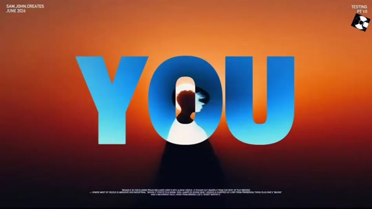
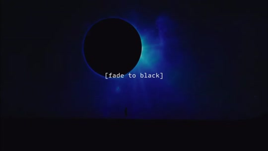

# SOMETHING REAL edit: Alan Watts over Rumari's ONE

Source: [original reel](https://www.instagram.com/reel/DfphPQ0BPTS/) (Instagram video, @sam.john.creates, about 26 seconds, posted 2026-11-12).

**Provenance.** Sent to the archive as a bare link on 2026-11-13 at 07:44 JST. Recorded here: the caption (verbatim below), the on-screen text and visuals read from the downloaded video's sampled frames, and the production credits from the caption. The audio was not transcribed; the speech is identified from the burned-in captions and the well-known Alan Watts passage they quote.

**Caption (verbatim).** "Epilepsy warning

Song: ONE by @rumari___ 
Speech: Alan Watt
Edited: CapCut
AI Generations: @invideo.io 
SFX: Ocular Sounds, Artlist, and CapCut SFX Library
Brought to you by the universe

#creative #editing #videography" ("Alan Watt" as written; Alan Watts.)

**What it is.** A cinematic kinetic-typography edit, part of the creator's "TESTING" series (corner text: "SAM.JOHN.CREATES NOV 2026" and "TESTING PT VII"). Giant glitch-text frames spell out the speech beat by beat: "YOU", "THEEEE REAAAAAL", "SOMETHING", "THAT", "ALL", "DOING", "UNIVERSE", over AI-generated space and ocean imagery, an eclipse with "[fade to black]" caption, floating astronauts and a thermal-imaging figure. One burned-in caption reads "is something that the whole ocean is doing". The speech is the famous Alan Watts passage: "What you do is what the whole universe is doing at the place you call 'here and now'. You are something the whole universe is doing in the same way that a wave is something the whole ocean is doing."

194 likes and 5 comments at save (from video metadata, not independently checked). Same creator as r51 (Highs and Lows edit, item 292).

## Items

#### 328. The Book: On the Taboo Against Knowing Who You Are (Alan Watts, 1966)

Source of the reel's narration. The wave/ocean passage appears in the book and circulates as the spoken piece "The Real You": the reel's captions ("YOU ... SOMETHING ... THAT ... ALL ... DOING ... UNIVERSE", "is something that the whole ocean is doing") match it line for line. The audio was not transcribed, so the exact lecture cut used is unverified; the passage itself is confirmed against the on-screen text.

- [The Book (Penguin Random House)](https://www.penguinrandomhouse.com/books/187467/the-book-by-alan-watts/)
- [The Book (Internet Archive, free to borrow)](https://archive.org/details/bookontabooagain0000watt)
- [Alan Watts - The Real You (spoken version, YouTube)](https://www.youtube.com/watch?v=mMRrCYPxD0I)
- [Instagram reel](https://www.instagram.com/reel/DfphPQ0BPTS/)

#### 329. ONE - Rumari (from IDENTITY CRISIS!)

The track the edit is cut to, credited in the caption as "ONE by @rumari___". ONE sits on Rumari's album IDENTITY CRISIS! (per the Amazon Music listing). Match confirmed from the caption, not from the audio.

- [ONE on Spotify](https://open.spotify.com/track/1Anw7doq5i8nmDCNQaupoV)
- [Rumari on Spotify](https://open.spotify.com/artist/6HvBqgkf07g4SgAp53CRHE)
- [ONE on Amazon Music (IDENTITY CRISIS!)](https://music.amazon.fr/tracks/B0H56W48T9)

#### 330. The reel's production stack: CapCut + invideo.io AI + Ocular Sounds / Artlist / CapCut SFX

Everything the caption credits, with free/paid status:

- **CapCut** (editing + SFX library) - free editor; the built-in SFX library is free inside the app. Optional Pro tier.
- **invideo.io** (AI generations - the space/ocean/eclipse imagery here) - credit-based paid plans; Starter listed at $20/seat/mo billed annually ($10/mo promo shown at save).
- **Ocular Sounds** (SFX) - paid sound-effects packs (Complete Collection and Signature Series bundles).
- **Artlist** (SFX) - subscription, Music & SFX plans from $9.99/mo billed annually.

So the look itself (kinetic type over AI footage) is achievable for free in CapCut; the AI footage and two of the three SFX sources are paid.

- [invideo pricing](https://invideo.io/pricing/)
- [Ocular Sounds - Sound Effects Complete Collection](https://ocularsounds.com/products/sound-effects-complete-collection)
- [Artlist plans explained](https://artlist.io/blog/artlist-pricing-and-plans-explained/)
- [Instagram reel](https://www.instagram.com/reel/DfphPQ0BPTS/)
