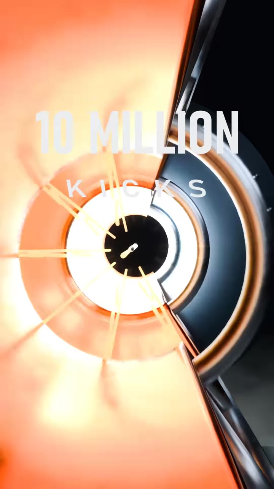
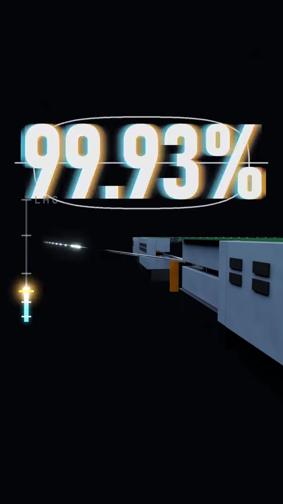

# LHC proton chase

Source: [original reel](https://www.instagram.com/reel/DfCPNjROIEi/) (Instagram video, @ooblixtv, about 37 seconds).

**Provenance.** Shotaro sent the bare link on 2026-10-29. Recorded here: the caption (verbatim below) and the on-screen text and visuals, read from sampled video frames. The audio was not transcribed. Claims about the collision are the creator's.

**Caption (verbatim).** "Made in Blender. Follow for more edits like this.

The collision at the end is real. CMS caught it in May 2012, a Higgs boson candidate that broke into 2 electrons and 2 muons ⚡
Every track you see is where a real particle went, and the blue one the camera rides in on is a real muon, all the way back to the point where two protons hit.
Naoya, Maki, speed is life, faster faster... same chase, but the hero is a proton in CERN's Large Hadron Collider." Tags: #naoya #speedislife #motivation #lhc #physics

**On-screen text, in order (from frames).** "SPEED OF ..." then "26.7 KM", "OPPOSITE WAYS", then a light-speed counter: "52% OF LIGHT" (LINAC4), "4 RINGS BOOSTER", "99% ... 99.1% ... 99.93% ... 99.9998% ... 99.999% OF LIGHT", "10 MILLION KICKS", "ONLY 10 KM/H SLOWER THAN LIGHT", "10 MICRONS APART", "1 MICRON APART", then the collision with red detector tracks. These are the creator's figures; not individually checked.

**What it is.** A first-person ride on a proton through CERN's accelerator chain up to the LHC, ending in an animated collision styled on a CMS event display. "Naoya, Maki" reads as a reference to another edit; I could not identify it, so nothing is attributed to it.

## Items

#### 287. CMS Higgs boson candidate event, ZZ to 2 electrons + 2 muons (8 TeV, 2012 data)

The collision at the end of the reel. The caption says CMS caught it in May 2012: a Higgs boson candidate that decayed to 2 electrons and 2 muons, and that every track shown is a real particle path, including the blue muon the camera rides in on. These are the creator's claims; the reel is a Blender animation built from the event, not the raw event display. CMS publishes a 2012 8 TeV candidate ZZ event with two electrons and two muons among its Higgs collision images; I could not confirm it is the same event as the reel's. The CERN Open Data record holds Higgs candidate events for education and outreach.

- [CMS: contributions to the discovery of a Higgs boson (collision images incl. 8 TeV ZZ to 2e2mu candidate)](https://cmsexperiment.web.cern.ch/content/cms-higgs-resources)
- [CERN Open Data: Higgs candidate events for education and outreach](https://opendata.cern.ch/record/cms-300)

_Edition note: links are reference pages, not availability or rights claims._

#### 288. Large Hadron Collider (CERN)

The whole reel follows one proton through CERN's collider. On screen: '26.7 KM' for the ring, 'OPPOSITE WAYS' for the two beams, and a running percent-of-light-speed counter (52%, 99%, 99.93%, 99.9998%, 99.999%) with '10 million kicks' and '1 micron apart' / '10 microns apart' for the beam squeeze before collision. These are on-screen figures; I did not check each against CERN sources.

- [CERN: Large Hadron Collider](https://home.cern/science/accelerators/large-hadron-collider/)

_Edition note: links are reference pages, not availability or rights claims._

#### 289. CERN accelerator chain shown in the reel: Linac4, Proton Synchrotron Booster, Proton Synchrotron, SPS

The reel labels 'LINAC4' (at 52% of light speed) and '4 RINGS BOOSTER' on its way up to the LHC. CERN's Booster page confirms four superimposed synchrotron rings fed by Linac4 (160 MeV in, 2 GeV out, to the Proton Synchrotron). The PS and SPS stages are my reading of the later frames and the CERN accelerator complex, not clearly labelled on screen.

- [CERN: accelerator complex](https://home.cern/science/accelerators/accelerator-complex)
- [CERN: Linear accelerator 4](https://home.cern/science/accelerators/linear-accelerator-4)
- [CERN: Proton Synchrotron Booster](https://home.cern/science/accelerators/proton-synchrotron-booster)

_Edition note: links are reference pages, not availability or rights claims._

#### 290. Blender

Caption: 'Made in Blender. Follow for more edits like this.' Free and open source 3D creation software.

- [Blender](https://www.blender.org/)

_Edition note: links are reference pages, not availability or rights claims._
