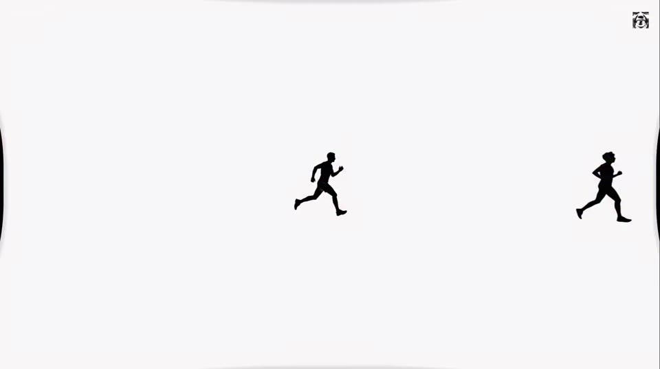
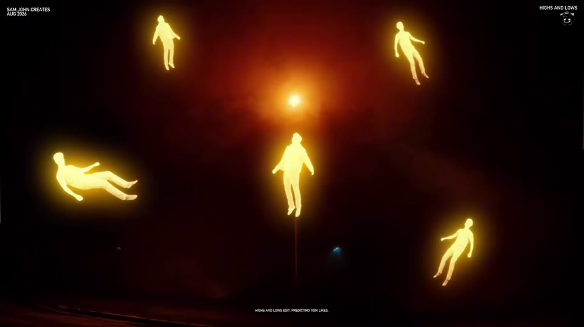
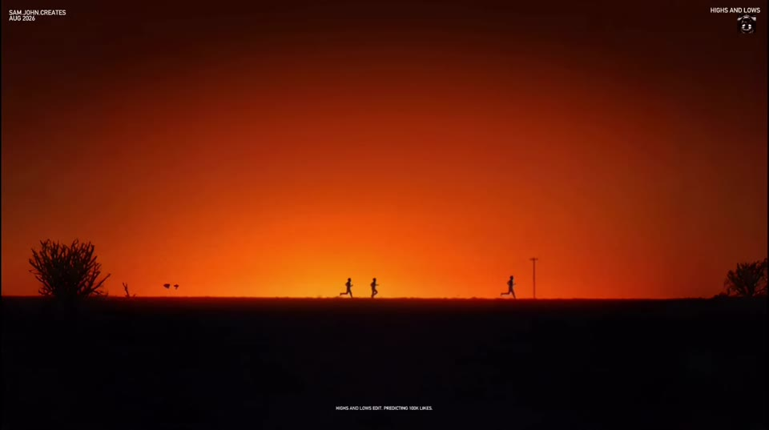
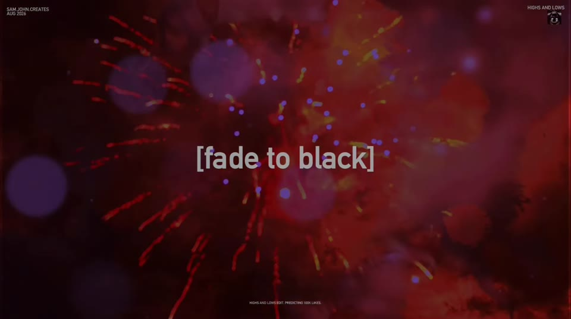

# Highs and Lows edit

Source: [original reel](https://www.instagram.com/reel/DcgnHXLK2Sc/) (Instagram video, @sam.john.creates, about 19 seconds, posted 2026-08-26).

**Provenance.** Shotaro sent the bare link on 2026-11-07. Recorded here: the caption (verbatim below) and the on-screen text and visuals, read from the downloaded video's sampled frames. The audio was not transcribed, so the music is not confirmed.

**Caption (verbatim).** "Nahhh I need to chill out

Investing at 0 likes, expecting a lot

@andretroutman @ye" Tags: #creative #editing #videography #cinematic

**What it is.** A short cinematic edit, not a tutorial. It opens on a technical schematic of a "realistic pocket radio" (dimensions, tuning dial, band selector, wrist strap), then cuts to glowing yellow floating figures, black silhouettes on white, orange-sunset silhouettes with "HIGHS AND LOWS" as giant title text, a crescent moon, and a "[fade to black]" over fireworks. Corner credit: "SAM.JOHN.CREATES, AUG 2026". Closing text: "HIGHS AND LOWS EDIT. PREDICTING 100K LIKES." No resource is named. About 175,000 likes at save (from page data, not independently checked).

## Items

#### 291. HIGHS AND LOWS (Ye, from BULLY)

The reel is titled 'Highs and Lows edit' on screen, and Ye released a track called HIGHS AND LOWS on BULLY (2026-03-28). The creator also tags @ye in the caption. I could not transcribe the reel's audio, so I did not confirm that this track is what plays. Treat the match as likely, not verified.

- [Ye - HIGHS AND LOWS (official video, YouTube, 1:51)](https://www.youtube.com/watch?v=kt_0b4RwerY)
- [HIGHS AND LOWS on Spotify (BULLY - Deluxe)](https://open.spotify.com/track/2rp6ug2Gm49BG2UdTNVzWW)

_Edition note: links are reference pages, not availability or rights claims._

#### 292. @sam.john.creates (creator of the edit)

Instagram account behind the reel. The edit mixes a technical-schematic opening (a realistic pocket radio), glowing floating figures, silhouettes against orange skies and a 'fade to black' ending. The on-screen credit reads 'SAM.JOHN.CREATES, AUG 2026' and the closing text reads 'HIGHS AND LOWS EDIT. PREDICTING 100K LIKES.'

- [sam.john.creates on Instagram](https://www.instagram.com/sam.john.creates/)

