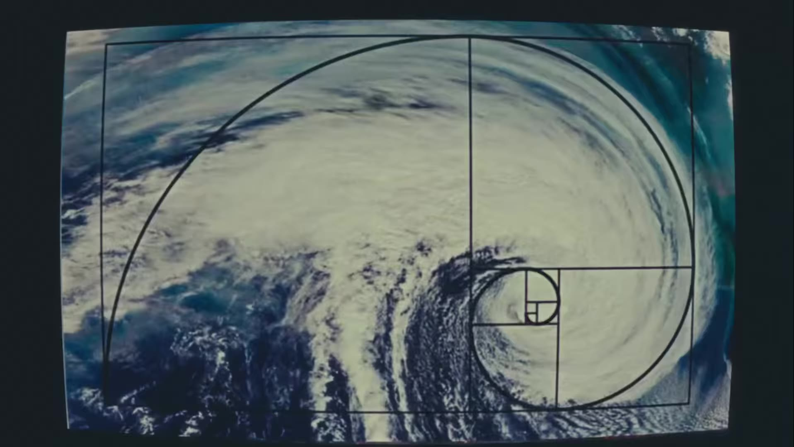
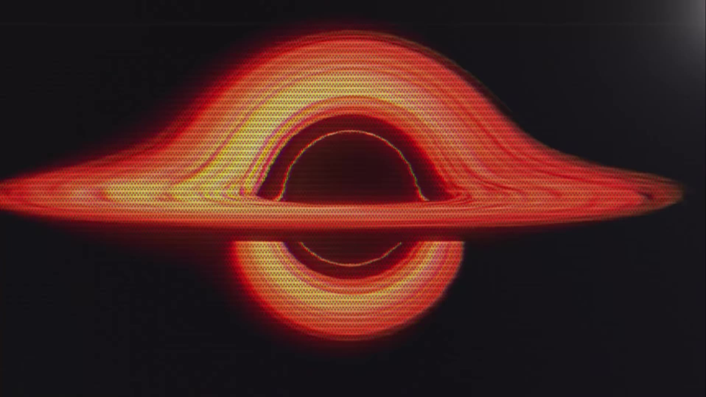
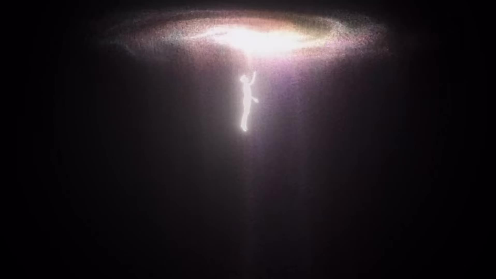
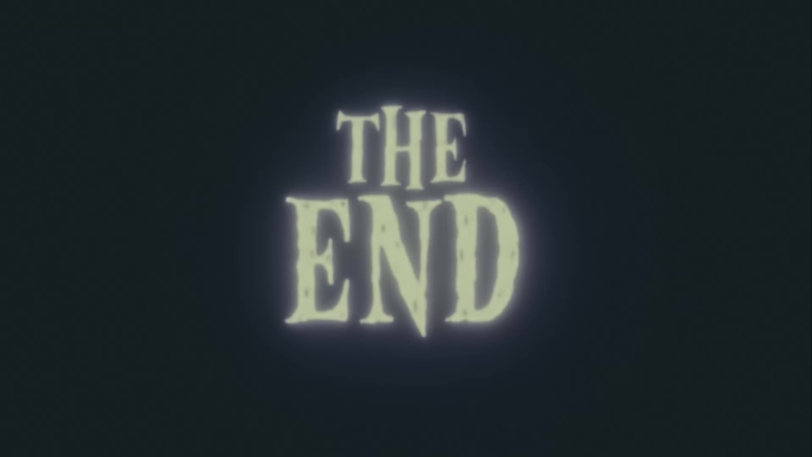

# Time feels this fast edit (byimraaan)

Source: [original reel](https://www.instagram.com/reel/Dc_2Y1qI0ZH/) (Instagram video, @byimraaan, about 12 seconds, posted 2026-09-07).

**Provenance.** Shotaro sent the bare link on 2026-11-07. Recorded here: the caption (verbatim below) and the on-screen text and visuals, read from the downloaded video's sampled frames. The audio has no speech and was not transcribed, so the music is not identified.

**Caption (verbatim).** "Time feels this fast when you live from the beginning to an end.⚡️

P.s Hoping to get 100K likes, so I can share the breakdown for anyone wanting to learn!" Tags: #creative #editing #videography #cinematic #aftereffects

**What it is.** A short cinematic edit about life from beginning to end, not a tutorial. It opens with black silhouettes walking on white, cuts to a hurricane seen from space with a golden-ratio (Fibonacci) spiral overlaid, a glowing figure wrapped in schematic/patent-style annotations (dashed arrows, coordinate boxes), an Interstellar-style black hole rendered with red scanlines, a glowing figure falling/rising toward a blinding light, RGB-glitch falling figures, an underwater view looking up at the light, an extreme close-up of a red-orange human eye, and ends on a vintage-film "THE END" title card. About 1,364,000 likes and 2,986 comments at save (from page data, not independently checked).

**On the promised breakdown.** The caption offers a tutorial breakdown once the reel hits 100K likes (it is far past that at save). Whether the breakdown was actually posted was not verified (Instagram profile browsing was not accessible); the reel itself names no resource pack.

## Items

#### 293. @byimraaan (creator of the edit)

Instagram account behind the viral 'Time feels this fast' edit. The reel moves through evolution/life imagery: walking silhouettes on white, a hurricane with a golden-ratio spiral, schematic-annotated glowing figures, an Interstellar-style black hole, an extreme close-up of a human eye, and a vintage 'THE END' card.

- [byimraaan on Instagram](https://www.instagram.com/byimraaan/)

#### 294. Adobe After Effects

Named in the caption tags (#aftereffects) as the tool the edit was made with. Paid (Adobe Creative Cloud subscription, free trial available).

- [Adobe After Effects](https://www.adobe.com/products/aftereffects.html)

