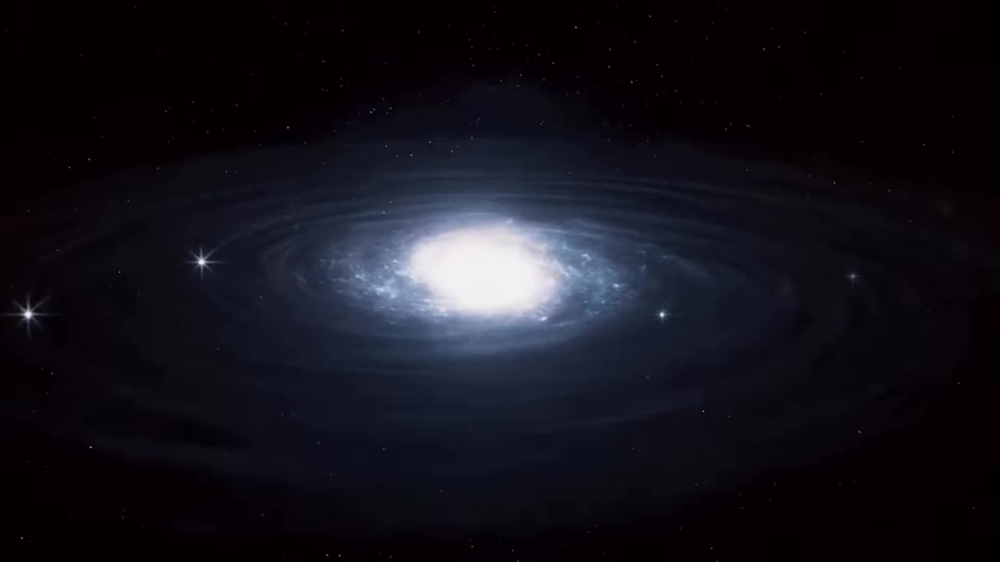
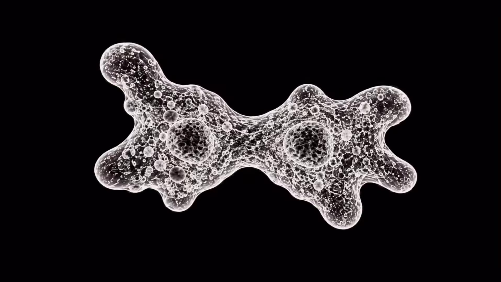
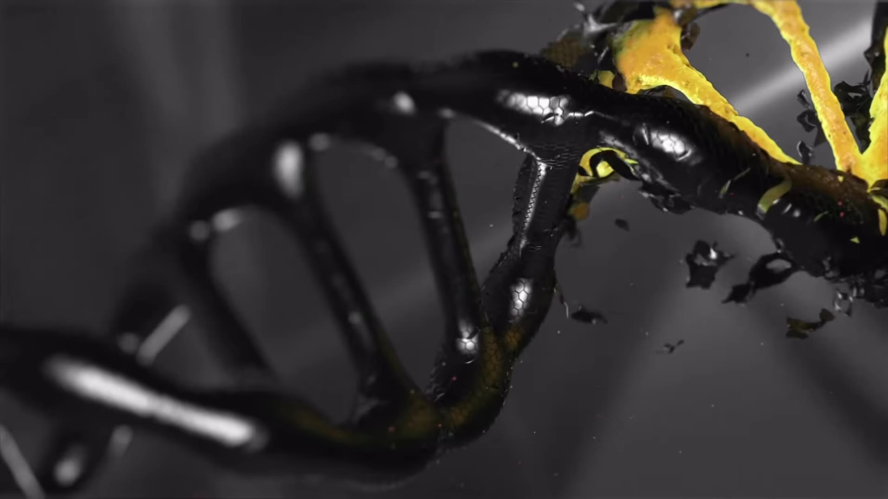
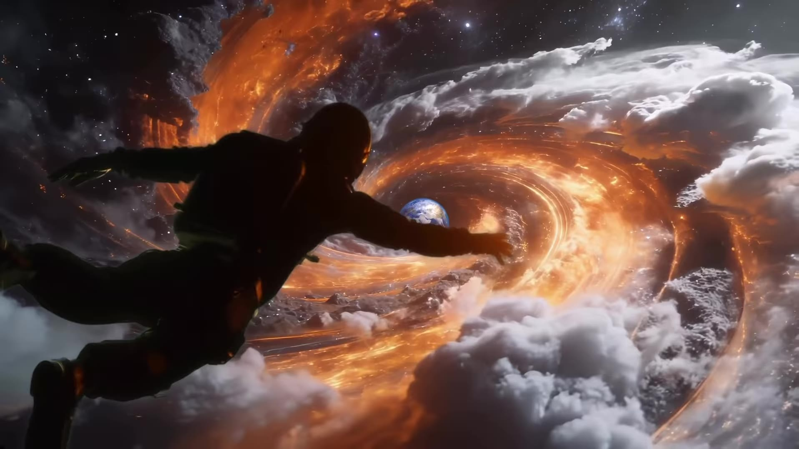

# Time feels this fast edit (sayantan_visuals)

Source: [original reel](https://www.instagram.com/reel/Dd_n-DjoF8J/) (Instagram video, @sayantan_visuals, about 11 seconds, posted 2026-10-02).

**Provenance.** Shotaro sent the bare link on 2026-11-07. Recorded here: the caption (verbatim below) and the on-screen text and visuals, read from the downloaded video's sampled frames. The audio has no speech and was not transcribed, so the music is not identified.

**Caption (verbatim).** "Time feels this fast when you live from the beginning to an end.
SFX : @kerolosmechail" Tags: #creative #editing #videography #cinematic #davinciresolve

**What it is.** A cinematic edit on the same caption/concept as r52 (byimraaan's 'Time feels this fast when you live from the beginning to an end', posted earlier on 2026-09-07 and far more viral; which version originated the format is unverified). Visuals: a spiral galaxy in a starfield, a dividing cell/amoeba (binary fission) on black, a golden lens flare, a glossy black DNA double helix with a yellow strand breaking apart, a glowing yellow human figure floating in a nebula between planets, and a silhouetted figure reaching/falling toward Earth wrapped in an orange energy vortex above the clouds. About 227,900 likes and 577 comments at save (from page data, not independently checked).

## Items

#### 295. @sayantan_visuals (creator of the edit)

Instagram account behind this take on the 'Time feels this fast' concept: cosmic and biological imagery (galaxy, cell division, DNA, glowing figure, fall toward Earth).

- [sayantan_visuals on Instagram](https://www.instagram.com/sayantan_visuals/)

#### 296. @kerolosmechail (SFX artist)

Sound designer credited in the caption ('SFX : @kerolosmechail'). Not otherwise verified.

- [kerolosmechail on Instagram](https://www.instagram.com/kerolosmechail/)

#### 297. DaVinci Resolve

Named in the caption tags (#davinciresolve) as the tool the edit was made with. Free base version; DaVinci Resolve Studio is a paid upgrade.

- [DaVinci Resolve](https://www.blackmagicdesign.com/products/davinciresolve)

