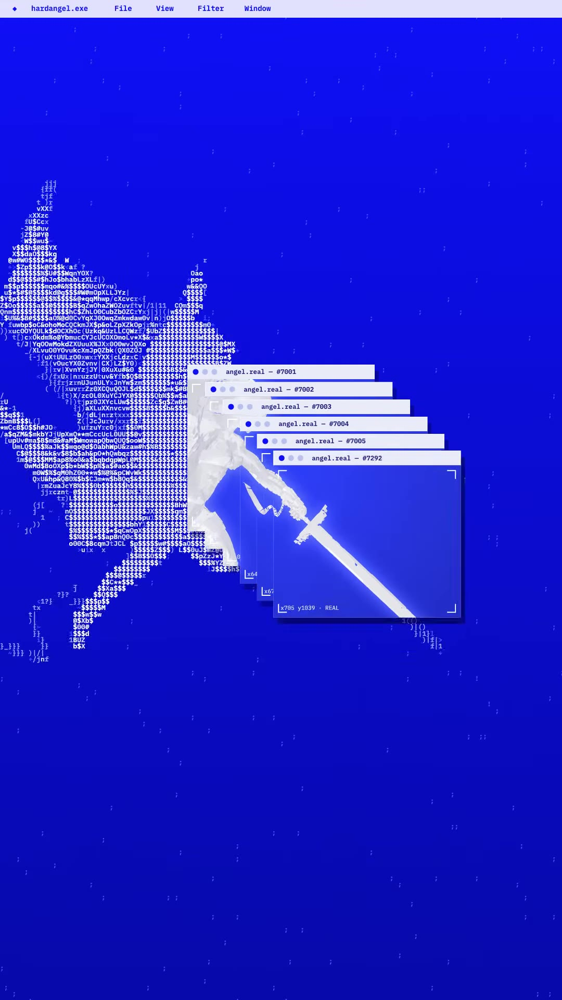
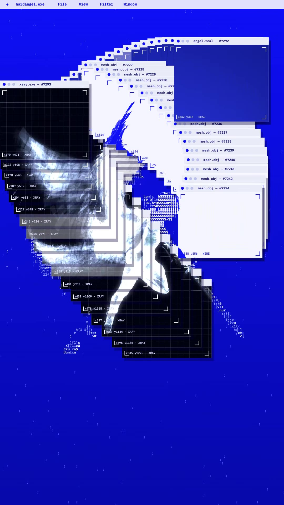
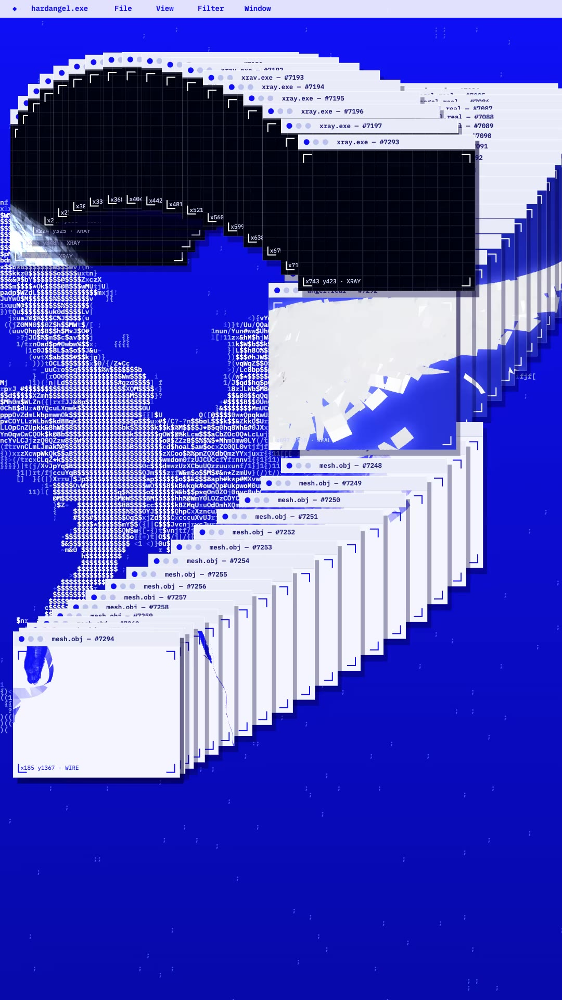

# 2N1T3 Casual Halloween promo (alessowiththei)

Source: [original reel](https://www.instagram.com/reel/DemngNxkd0T/) (Instagram video, @alessowiththei, about 13 seconds, posted 2026-10-17).

**Provenance.** Shotaro sent the bare link on 2026-11-07. Recorded here: the caption (verbatim below) and the on-screen text and visuals, read from the downloaded video's sampled frames. The audio has no speech and was not transcribed (presumably ALESSIO's music, unverified).

**Caption (verbatim).** "Halloween with the artists whose music keeps shaping and inspiring mine.

Playing CASUAL HALLOWEEN alongside @casualafffairs @frenchfordrugs @wrclw_ @thisisglitterbeach. On the 29th I'll be unveiling unreleased work for the first time 👼⚙️

👻 Thu, Oct 29 · @hightidedtla, LA
More info at @2n1t3app or link in bio"

**What it is.** A promo edit for the 2N1T3 CASUAL HALLOWEEN #06 party (Thu 2026-10-29, High Tide, downtown LA; past as of save). The visual language is Y2K/webcore: a deep-blue desktop titled 'hardangel.exe', ASCII-art figures (an angel with a sword, a dove) and cascading macOS-style windows labelled 'angel.real', 'xray.exe' and 'mesh.obj' with coordinate tags marked REAL, XRAY and WIRE. About 10,400 likes and 31 comments at save (from page data, not independently checked).

## Items

#### 298. 2N1T3 CASUAL HALLOWEEN #06 (event)

The event the reel promotes: Thursday 2026-10-29 at High Tide, downtown Los Angeles, with ALESSIO, Casual Affairs, French For Drugs, WRCLW and Glitter Beach. Listed on the 2N1T3 app/site and DICE (links found by search; the event is past as of save).

- [2N1T3 event page](https://www.2n1t3.com/e/2n1t3-casual-halloween-06)
- [DICE ticket listing](https://dice.fm/event/53kkkw-2n1t3-casual-halloween-06-29th-oct-high-tide-los-angeles-tickets)

#### 299. Casual Affairs (@casualafffairs)

Artist on the bill, tagged in the caption.

- [Casual Affairs on Spotify](https://open.spotify.com/artist/5EESQeFhNh3C79v3mLKe2W)
- [casualafffairs on Instagram](https://www.instagram.com/casualafffairs/)

#### 300. French For Drugs (@frenchfordrugs)

Artist on the bill, tagged in the caption.

- [French For Drugs on Spotify](https://open.spotify.com/artist/6VI38wBrLiN4t3QD8MuGyg)
- [frenchfordrugs on Instagram](https://www.instagram.com/frenchfordrugs/)

#### 301. @wrclw_ (WRCLW)

Artist on the bill, tagged in the caption. No verified music page found; Instagram only.

- [wrclw_ on Instagram](https://www.instagram.com/wrclw_/)

#### 302. Glitter Beach (@thisisglitterbeach)

Artist on the bill, tagged in the caption. No verified music page found; Instagram only.

- [thisisglitterbeach on Instagram](https://www.instagram.com/thisisglitterbeach/)

#### 303. High Tide (DTLA venue)

The downtown Los Angeles venue hosting the event (kind set to website because the archive vocabulary has no place kind).

- [hightidedtla.com](https://hightidedtla.com/)

#### 304. ALESSIO (@alessowiththei)

Creator of the reel; played the event and teased unveiling unreleased work there. No verified music page found; Instagram only.

- [alessowiththei on Instagram](https://www.instagram.com/alessowiththei/)

