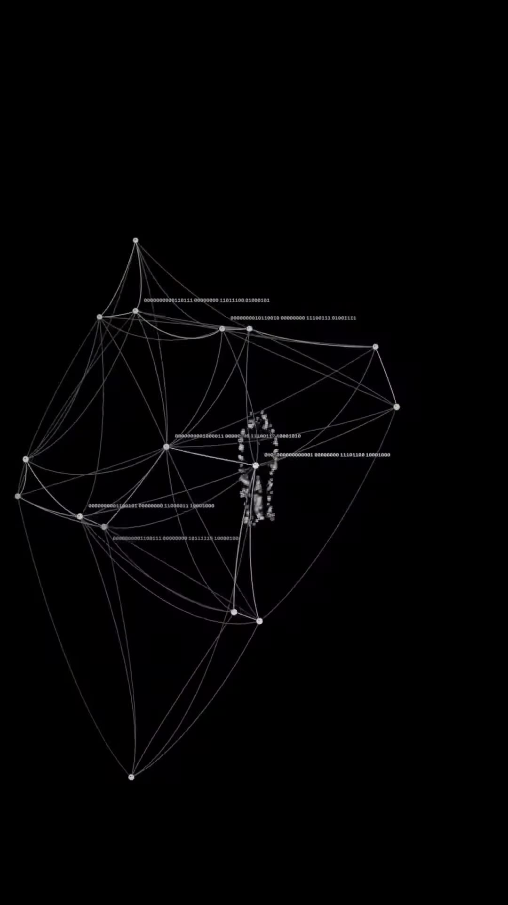

# Synthetic Urban 11 (criswvr)

Source: [original reel](https://www.instagram.com/reel/DenH5zFssrg/) (Instagram video, @criswvr, about 7 seconds, posted 2026-10-17).

**Provenance.** Shotaro sent the bare link on 2026-11-07. Recorded here: the caption (verbatim below) and the on-screen text and visuals, read from the downloaded video's sampled frames. The audio has no speech and was not transcribed.

**Caption (verbatim).** "Synthetic Urban 11"

**What it is.** Installment 11 of CRIS WAR's 'Synthetic Urban' animation series. On black, a tiny human figure made of glowing wireframe nodes and lines floats in the dark, grows into a large triangulated point-cloud mesh strung with binary code (000000010111 ...), then the frame flips to white with a small object-detection-style box (labelled '1.0') around a still of a man in a black suit holding a briefcase, before cutting to black. About 3 likes and 18 comments at save (from page data, not independently checked).

## Items

#### 305. CRIS WAR (@criswvr) - Synthetic Urban series

Artist behind the 'Synthetic Urban' digital-surveillance animation series; this reel is installment 11. A making-of write-up of the series' point-cloud surveillance look exists on alici.ai (reference page found by search).

- [criswvr.com](https://criswvr.com/)
- [criswvr on Instagram](https://www.instagram.com/criswvr/)
- [How criswvr Made This Synthetic Urban Digital Surveillance Animation (alici.ai)](https://alici.ai/formulas/media/criswvr/e13be832-919c-532f-aa30-0ab1cf3c2191-synthetic-urban-digital-surveillance-point-cloud-animation)

