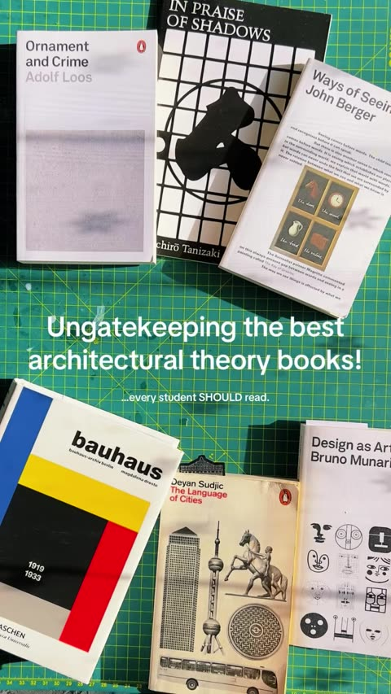
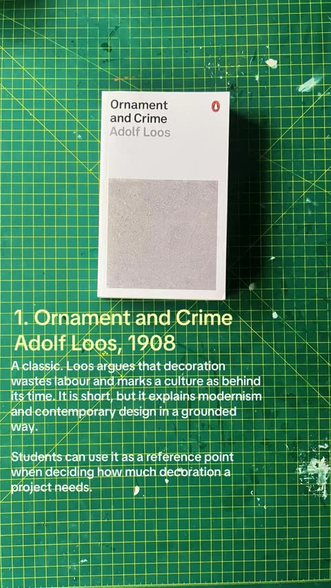
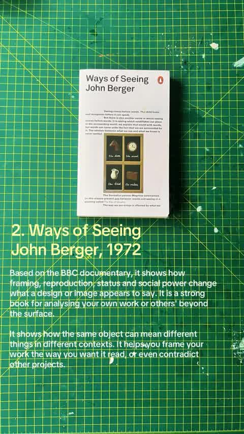

# Ungatekeeping: architectural theory books, Part 1 (matthewarchitect)

Source: [original reel](https://www.instagram.com/reel/DfYIEZlz1af/) (Instagram video, @matthewarchitect, about 12.5 seconds, posted 2026-11-05).

**Provenance.** Sent to the archive as a bare link on 2026-11-07, with a follow-up asking for the rest of the series. Recorded here: the caption (verbatim below) and the on-screen text, read from the downloaded video's sampled frames. The audio is background music with no speech and was not transcribed.

**Caption (verbatim).** "Ungatekeeping the best architectural theory books every student should read. (Part 1)

Not all of them are about buildings, and that's the point. Each one teaches you to question why something looks the way it does, and how it gets read by others.

1. Ornament and Crime, 1908, Adolf Loos
2. Ways of Seeing, 1972, John Berger
3. In Praise of Shadows, 1933, Jun'ichiro Tanizaki
4. Bauhaus, 1990, Magdalena Droste
5. The Language of Cities, 2016, Deyan Sudjic
6. Design as Art, 1966, Bruno Munari

For the Melbourne folks, I think most, if not all, of these came from Metropolis Bookstore.

Any other recommendations? Drop them in the comments."

**What it is.** Physical copies of the six books laid on a green gridded cutting mat; each book gets a numbered title card (title, author, year) and a short on-screen review. Closes with "Have you read any already?" About 285 likes and 1 comment at save (from page data, not independently checked). The same list also appears as a photo carousel on the same account ([p/DfYHdXqk5SG](https://www.instagram.com/p/DfYHdXqk5SG/)).

**Series status (checked 2026-11-07).** The caption marks this "(Part 1)". No Part 2 found in the creator's newer posts: the only posts after it are the carousel twin of the same list, then unrelated architecture content (Kengo Kuma's Copenhagen bath house, Soviet-era mother statues). The creator runs the same "Ungatekeeping" format on other topics - Melbourne architecture/design bookstores (reel [DfQT5HWT5c1](https://www.instagram.com/reel/DfQT5HWT5c1/)) and architecture references that aren't Pinterest (carousel [DfR9FmuE7YQ](https://www.instagram.com/p/DfR9FmuE7YQ/)). Those are sibling posts in the format, not parts of this book series.

## Items

#### 306. Ornament and Crime (1908) - Adolf Loos

Reel's review: "A classic. Loos argues that decoration wastes labour and marks a culture as behind its time. It is short, but it explains modernism and contemporary design in a grounded way. Students can use it as a reference point when deciding how much decoration a project needs." Originally a 1908 lecture, first published 1908/1929; the Penguin Great Ideas edition is pictured.

- [Wikipedia](https://en.wikipedia.org/wiki/Ornament_and_Crime)
- [Full text, English translation (University of Washington)](https://depts.washington.edu/vienna/documents/Loos/Loos_Ornament.htm)

#### 307. Ways of Seeing (1972) - John Berger

Reel's review: "Based on the BBC documentary, it shows how framing, reproduction, status and social power change what a design or image appears to say. It is a strong book for analysing your own work or others' beyond the surface. It shows how the same object can mean different things in different contexts."

- [Penguin](https://www.penguin.co.uk/books/56465/ways-of-seeing-by-berger-john/9780141035796)

#### 308. In Praise of Shadows (1933) - Jun'ichiro Tanizaki

Reel's review: "Another classic. This Japanese essay helps us look deeper into our own inhibitions as designers, through traditional Japanese aesthetics. Many architecture students use Japanese inspiration as key touchpoints. This book shows where those choices come from, without being a building guide." Also in the archive as item 63 (r10).

- [Wikipedia](https://en.wikipedia.org/wiki/In_Praise_of_Shadows)
- [Tuttle edition](https://www.tuttle.co.jp/products/show/isbn:9784805318041/language:en)

#### 309. Bauhaus (1990) - Magdalena Droste

Reel's review: "More a history than an academic book, and essential for understanding modern architecture. It shows how the school balanced individuality with standardisation and function. Useful for students who want individuality but need designs that are realistic to build." The Taschen edition (Bauhaus 1919-1933) is pictured.

- [Taschen](https://www.taschen.com/en/books/architecture-design/43440/bauhaus-updated-edition/)

#### 310. The Language of Cities (2016) - Deyan Sudjic

Reel's review: "Useful for master planning. Sudjic sees cities shaped more by power, money and ego than by planning, and ties buildings to the people who commissioned them. Students can use it to see what actually drives big projects beyond the drawings."

- [Penguin](https://www.penguin.co.uk/books/280291/the-language-of-cities-by-sudjic-deyan/9780141980591)
- [Author's site](https://www.deyansudjic.com/books/the-language-of-cities)

#### 311. Design as Art (1966) - Bruno Munari

Reel's review: "Munari sees design more from the art world than the architecture world. He treats it as an everyday way of communicating culture through material. Students can use it to stop borrowing references that have no context for their site, and to communicate their design better."

- [Penguin](https://www.penguin.co.uk/books/19371/design-as-art-by-bruno-munari/9780141035819)

#### 312. Metropolis Bookshop (Melbourne)

The caption's source for the list: "I think most, if not all, of these came from Metropolis Bookstore." Architecture and design bookshop on Level 3 of Curtin House, Swanston Street, Melbourne.

- [Metropolis Bookshop](https://metropolisbookshop.com.au/pages/1354-aboutus)
