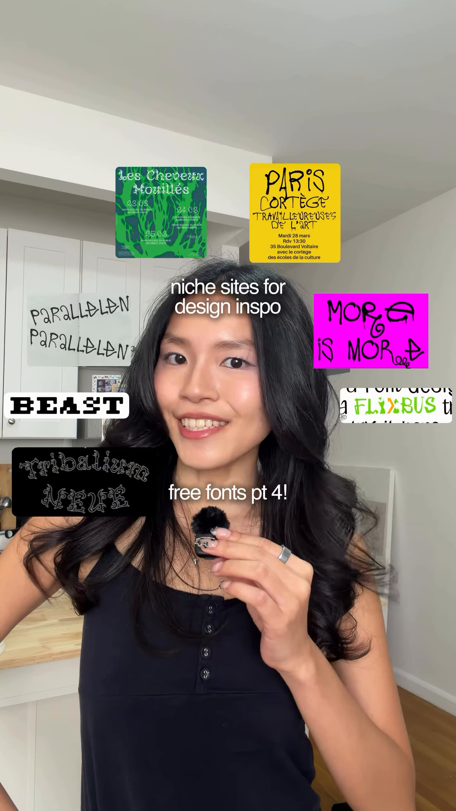
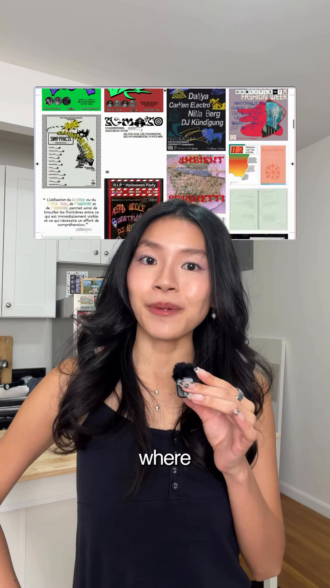
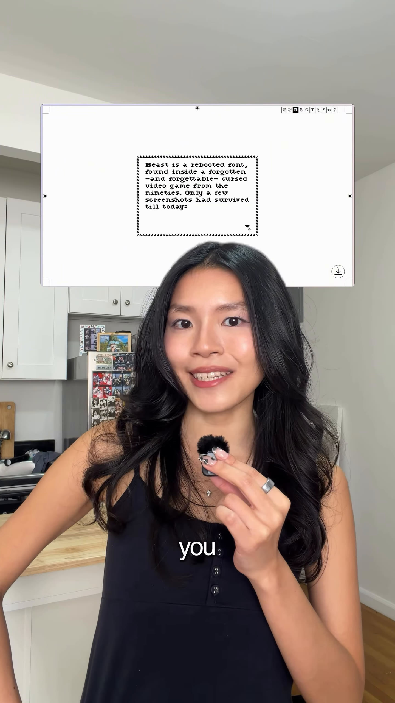

# Free fonts pt 4: fonderie.download (mightbemaxi)

Source: [original reel](https://www.instagram.com/reel/DfAHXhZRW5O/) (Instagram video, @mightbemaxi, about 16 seconds, posted 2026-10-27).

**Provenance.** Sent to the archive as a bare link on 2026-11-07. Recorded here: the caption (verbatim below) and the on-screen text, read from the downloaded video's sampled frames. The audio is speech; only the word-by-word on-screen captions were transcribed, not the full voiceover.

**Caption (verbatim).** "tbh their site is so cool u should check it out even if u dont need a font rn 😭

comment "fonts" & ill send it to u! 💌

#typography #graphicdesign #designresources #designinspiration"

**What it is.** Maxine talks to camera with the site screen-shared above her, under the overlays "niche sites for design inspo" and "free fonts pt 4!". The word-by-word captions describe an experimental foundry whose fonts are free for commercial use, with a page where people show what they made with the fonts. On screen she scrolls the foundry homepage (specimens for Beast, Quarantype, Zara and Tribalium visible), the Crédible and Beast font pages, both Tribalium styles, and the "fonts in use" gallery grid. Closes with "comment 'fonts' & i'll send you the link!". About 4,187 likes at save (from video metadata, not independently checked). This is part 4 of her "free fonts" series; parts 1-3 were not extracted.

**Comment-bait resolution.** No comment or DM needed: the link is just the public site **[fonderie.download](https://fonderie.download/)**, a French experimental type foundry ("fonderie.download is your new favorite website. We design and distribute typefaces."). Free vs paid, plainly: everything on the site is free, commercial use included - all seven fonts are released under the [WTFPL](http://www.wtfpl.net/) ("you can literally do what the fuck you want to with them"). No account or paywall; the homepage offers a single zip with every font; the foundry says it collects no data and stays off social media by choice (email only). (Checked 2026-11-07.)

## Items

#### 313. fonderie.download - experimental type foundry

The site the whole reel points to. Seven display fonts with playful single-page specimens (draggable posters, crop marks, a try-it tester), a "fonts in use" gallery of work people emailed in, a newsletter, and a one-click zip of all fonts. All fonts WTFPL, free for commercial use.

- [fonderie.download](https://fonderie.download/)
- [Fonts in use gallery](https://fonderie.download/fontsinuse.html)
- [Download all the fonts (zip)](https://fonderie.download/downloads/FD_allthefonts.zip)

#### 314. Beast

Serif pixel font with a 5-pixel cap height, "a rebooted font, found inside a forgotten -and forgettable- cursed video game from the nineties" (a Mega Drive game, per its readme; only a few screenshots survived). Compact letters, clogged apertures, makeshift ligatures, deliberately weird type colour. Version 2.0, published November 2024. Its page is shown in the reel.

- [Beast font page](https://fonderie.download/beast.html)

#### 315. Crédible

Tall condensed display face: "For the streets, by the streets. Three different stylistic sets and several stunning ligatures to speak up for yourself!" Its page is shown in the reel, including "(Hmmm?)" and "CRÉDIBLE" specimens and a "MORG IS MORDE" sticker.

- [Crédible font page](https://fonderie.download/credible.html)

#### 316. Tribalium Neue

Capitals-only tribal/tattoo face "designed to torture your eyes", in two styles (Regular and Poster) - "Both styles will be equally useful for your next tattoo idea!" Designed 2018 by the fonderie.download team, published January 2020. Both styles are shown in the reel.

- [Tribalium Neue font page](https://fonderie.download/tribaliumneue.html)

#### 317. 4 Fromages

Display typeface created "with 8 hands" during the first Saturday Type Fever, a type-marathon hosted by NoFoundry in Karlsruhe in 2018, by Francois Elain, lazy dog and fonderie.download. Part of the seven-font catalog on the homepage; not clearly identifiable in the reel frames.

- [4 Fromages font page](https://fonderie.download/4fromages.html)

#### 318. Garamon(d/t)

"A hardcore revival of a revival": expert Paul Tubert scanned and smashed the 1926 Deberny et Peignot Garamond (itself based on sixteenth-century Claude Garamont) into regular and italic versions. "Stop bothering about the spelling no more, use Garamon(d/t)!" Part of the seven-font catalog; not clearly identifiable in the reel frames.

- [Garamon(d/t) font page](https://fonderie.download/garamondt.html)

#### 319. Quarantype

A collaborative font designed during the Covid-19 lockdown, with dozens of credited contributors (Alain Foncier, Anton Maous, lazy dog, louis souêtre and many more). Its stacked name is visible on the reel's homepage scroll.

- [Quarantype font page](https://fonderie.download/quarantype.html)

#### 320. Zara

"a font designed during a trip", with an interactive try-it tester on its page. Its specimen is visible on the reel's homepage scroll.

- [Zara font page](https://fonderie.download/zara.html)
