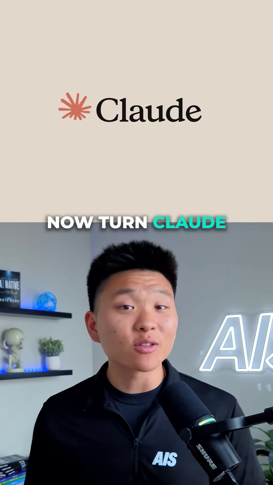
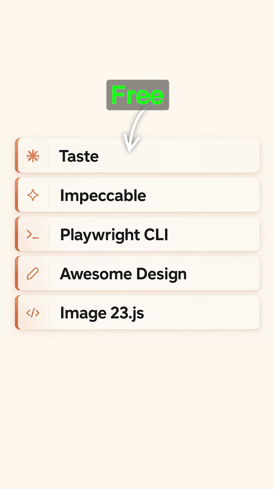

# Five free tools that turn Claude into a frontend designer (nateherkai)

Source: [original reel](https://www.instagram.com/reel/DdT_OwyFeoj/) (Instagram video, @nateherkai, about 38.6 seconds, posted 2026-09-15).

**Provenance.** Sent to the archive as a bare link on 2026-11-07. Recorded here: the caption (verbatim below) and the on-screen text, read from the downloaded video's sampled frames. The audio is speech; only the word-by-word on-screen captions were transcribed, not the full voiceover.

**Caption (verbatim).** "Comment 'FRONTEND' and I'll send it over."

**What it is.** Nate Herk talks to camera with screen recordings above him, under numbered overlays. He pitches five free tools that keep Claude (and other coding agents) from producing generic-looking sites, showing before/after demos: a florist site ("Botanic Architecture"), a hotel site ("Aurelia") with an in-browser pick-and-accept review toolbar, a dark "AEON" product site, and a Ducati motorbike rebuilt as a 3D model. A closing recap card labels the whole list "Free": Taste, Impeccable, Playwright CLI, Awesome Design, Image 23.js (the stylized recap name for img2threejs, shown in its segment as the img2threejs GitHub repo). About 18,425 likes at save (from video metadata, not independently checked).

**Comment-bait resolution.** No comment or DM needed: all five tools are public and free. Three of the five were already archived from [r13](13-claude-design-plugins.md) (an earlier "five Claude Code plugins" reel): Taste = item 94, Awesome DESIGN.md = item 96, Playwright CLI = item 98. The two genuinely new tools are items 321 and 322 below. Free vs paid, plainly: every tool named in this reel is free and open source - Taste (taste-skill repo), Impeccable, Playwright CLI (Apache-2.0, Microsoft), Awesome DESIGN.md (MIT) and img2threejs (Apache-2.0). (Checked 2026-11-07.)

## Items

#### 321. Impeccable

Claude Code plugin/skill pack shown second in the reel: "Design fluency for AI harnesses. Great design prompts require design vocabulary. Most people don't have it. You can't ask for 'more vertical rhythm' if you've never used those words. Impeccable gives you commands that put designer language in your hands." On-screen step 1: "Install the skills. One command. Every provider." Free and open source (GitHub, pbakaus/impeccable).

- [GitHub](https://github.com/pbakaus/impeccable)

#### 322. img2threejs

GitHub project shown fourth in the reel (the recap card's "Image 23.js"): "Rebuild the object in a reference image as a code-only, procedural Three.js model. Animation-ready, and deliberately token-efficient - reconstruction-by-code, not photogrammetry, mesh extraction, or downloaded art packs." Apache-2.0 license, runtime Three.js, tooling Python 3.10+ stdlib, version 1.4.4 at save, sponsored by Atlas Cloud. The demo rebuilds a red Ducati as a rotating 3D model. Free and open source.

- [GitHub](https://github.com/img2threejs/img2threejs)

#### Already in the archive (repeats of r13)

- **Taste** - the taste-skill anti-slop frontend skills pack, [item 94](13-claude-design-plugins.md#94-tasteskill---anti-slop-frontend-skills) (github.com/LeonxLnx/taste-skill, tasteskill.dev). Shown first in this reel, pulling design references (colors, typography, spacing).
- **Awesome DESIGN.md** - the DESIGN.md directory project, [item 96](13-claude-design-plugins.md#96-awesomedesign---directory-of-designmd-files). This reel shows its GitHub repo ([VoltAgent/awesome-design-md](https://github.com/VoltAgent/awesome-design-md), MIT license, "Curated collection of DESIGN.md analysis by developer focused websites", 73 files on the on-screen badge); the repo's homepage is the same getdesign.md project family archived under r13.
- **Playwright CLI** - Microsoft's official CLI for coding agents, [item 98](13-claude-design-plugins.md#98-playwright-cli---browser-screenshots-for-coding-agents) (playwright.dev). Shown third: Claude opens the built site in a real browser (multiple browsers), picks elements and accepts design edits directly in the page.
