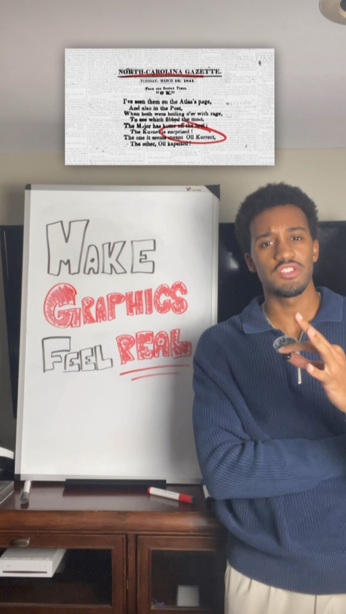
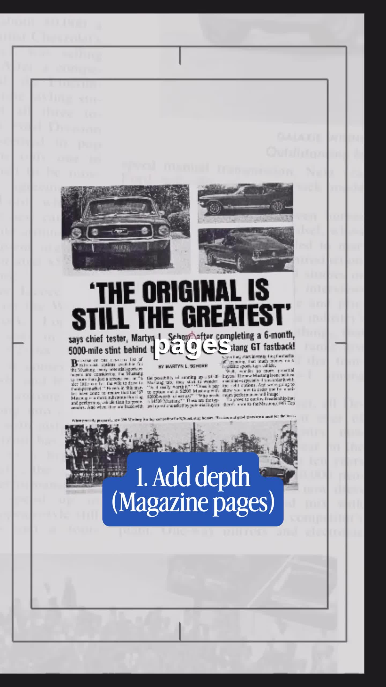
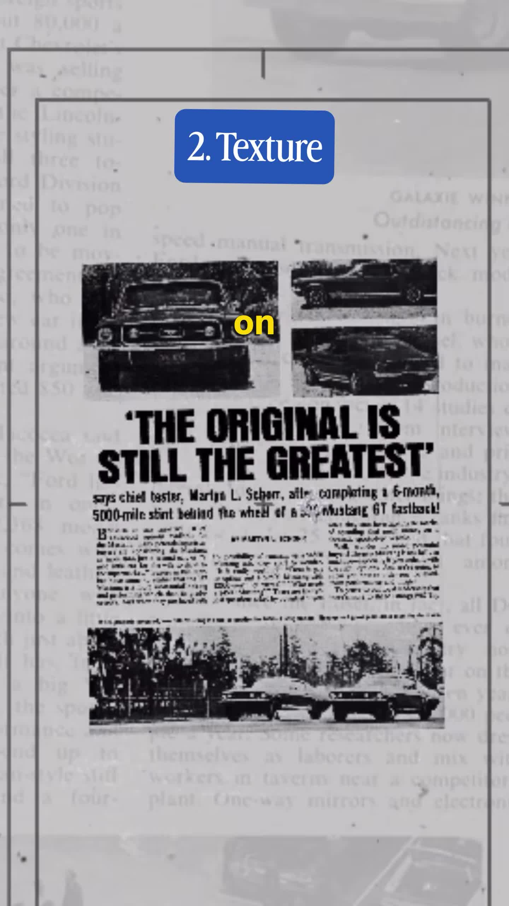
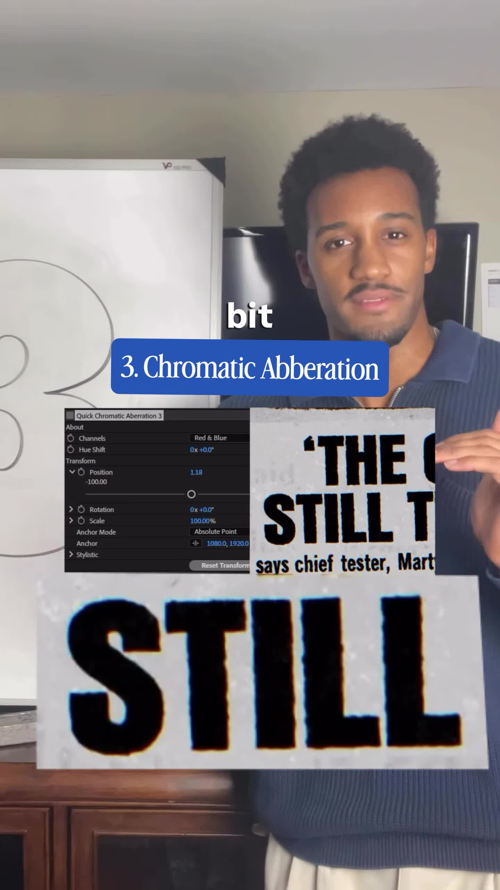
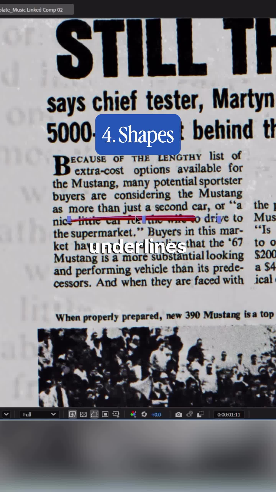
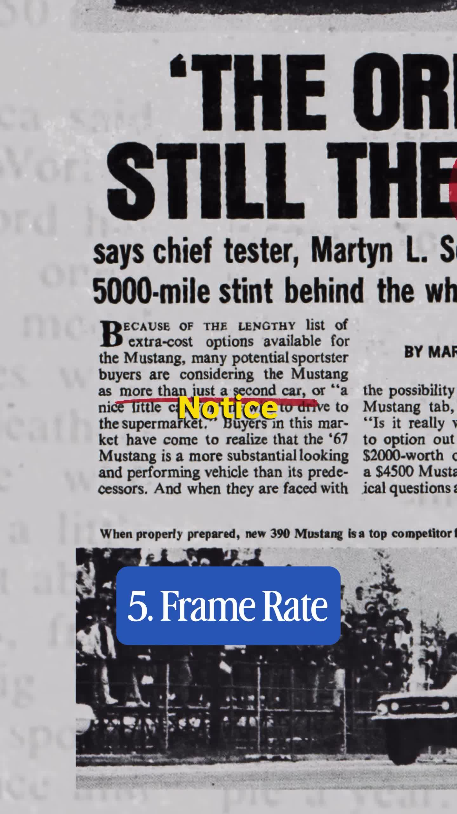

# Steal Like An Editor Ep 3: five ways to make graphics feel real (thebrandonc_)

Source: [original reel](https://www.instagram.com/reel/DeFb3XytnDF/) (Instagram video, @thebrandonc_, about 66 seconds, posted 2026-10-04).

**Provenance.** Sent to the archive as a bare link on 2026-11-08. Recorded here: the caption (verbatim below) and the on-screen text, read from the downloaded video's sampled frames. The audio is speech; only the word-by-word on-screen captions were transcribed, not the full voiceover.

**Caption (verbatim).** "steal this from your favorite creators👀 #videoeditor #contentcreator"

**What it is.** Episode 3 of Brandon Carpenter's whiteboard series "Steal Like An Editor" (whiteboard: "MAKE GRAPHICS FEEL REAL"). Talking to camera at the board, he opens on collaged 1841 newspaper clippings - the North-Carolina Gazette of March 16, 1841 (the famous early "O.K." poem, "The one it seems meant Oll Korrect"), The Daily Picayune and The Free Trader - then demos five techniques on a 1967 Ford Mustang GT magazine ad ("'THE ORIGINAL IS STILL THE GREATEST' says chief tester, Martyn L. Schorr, after completing a 6-month, 5000-mile stint behind the wheel of a '67 Mustang GT fastback!"). Each technique gets a numbered blue overlay card:

1. **Add depth (Magazine pages)** - layer scanned old magazine/newspaper pages behind and around the graphic so it sits inside real print, not on a blank canvas.
2. **Texture** - add grain, scratches and aberration on top; "clean" reads as digital, texture makes it feel alive, like old prints.
3. **Chromatic Aberration** - a small RGB channel split on the type (his screen shows a "Quick Chromatic Aberration 3" effect panel, Red & Blue channels, position -100) so the edges frange like printed ink.
4. **Shapes** - hand-drawn red circles and underlines around the key words ("GREATEST" circled, a line under the body copy), with opacity adjusted.
5. **Frame Rate** - run the animation at a lowered/imperfect frame rate; his closing point is that imperfections are what feel real, so each layer is a deliberate choice - count how many layers your favorite creators stack.

About 2,669 likes and 15 comments at save (from video metadata, not independently checked).

## Items

#### 323. Steal Like An Editor Ep 3 (technique set)

The reel itself as a reusable recipe: five layers that make digital graphics read as physical print - (1) real magazine/newspaper pages for depth, (2) grain + scratches texture, (3) subtle chromatic aberration, (4) hand-drawn red circles/underlines, (5) lowered, imperfect frame rate. Episode 3 of @thebrandonc_'s "Steal Like An Editor" series; episodes 1-2 not extracted. Everything shown is standard editor tooling (After Effects on screen), no paid pack named.

- [Instagram reel](https://www.instagram.com/reel/DeFb3XytnDF/)

#### 324. 1967 Ford Mustang GT magazine ad ("The Original Is Still The Greatest")

The demo material: a 1967 magazine ad quoting chief tester Martyn L. Schorr after a 6-month, 5,000-mile stint in a '67 Mustang GT fastback. Used on screen as the graphic that receives all five treatments.

- [Shown in the reel](https://www.instagram.com/reel/DeFb3XytnDF/)

#### 325. North-Carolina Gazette 1841 "O.K." poem clipping

The opening collage image: the March 16, 1841 North-Carolina Gazette poem ending "The one it seems meant Oll Korrect, The other, Oll Kaput!" - one of the earliest printed uses of "O.K." Shown alongside clippings from The Daily Picayune and The Free Trader as the "real print" texture reference.

- [Shown in the reel](https://www.instagram.com/reel/DeFb3XytnDF/)
