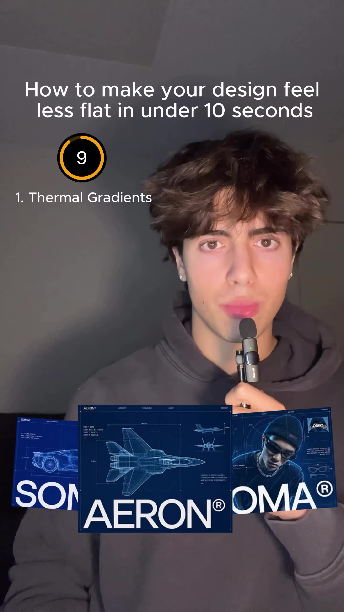
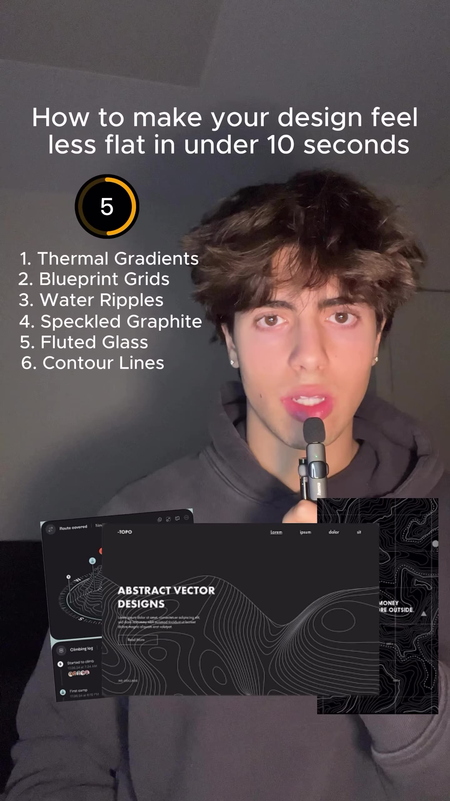
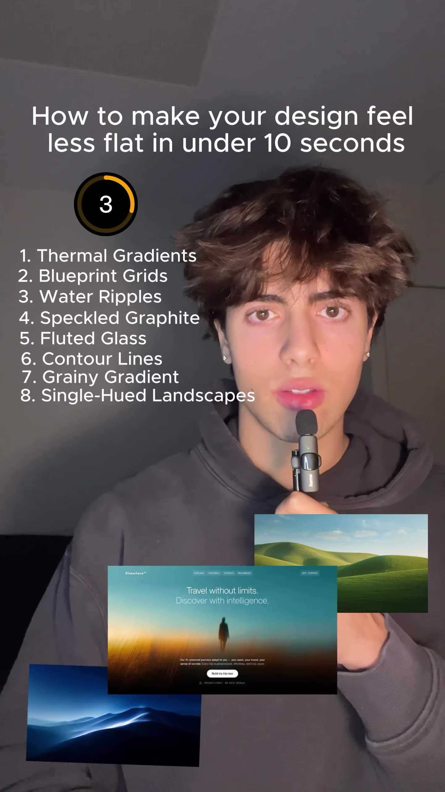
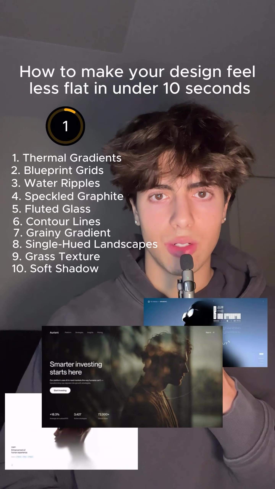

# How to make your design feel less flat in under 10 seconds (lnunesdesigns)

Source: [original reel](https://www.instagram.com/reel/DfiPWcGRFfc/) (Instagram video, @lnunesdesigns, exactly 10 seconds, posted 2026-11-09).

**Provenance.** Sent to the archive as a bare link on 2026-11-10. Recorded here: the caption (verbatim below), the on-screen list read from the downloaded video's sampled frames, and the voiceover, fully transcribed from the extracted audio.

**Caption (verbatim).** "Use these to make your project feel less flat #business #agency #design #entrepreneur"

**What it is.** A 10-second countdown by designer Nunes (@lnunesdesigns): a numbered list of ten textures/treatments to keep web and brand design from reading flat, each illustrated with example design shots that fly past at the bottom of the frame. The countdown timer ticks 10 to 1 as the list grows one line at a time.

The ten techniques, in the reel's order:

1. **Thermal Gradients** - heat-map-style multicolor gradient blurs (example shots: iridescent "Gradient" poster work).
2. **Blueprint Grids** - technical blueprint/drafting grid backgrounds.
3. **Water Ripples** - water-surface and ripple photography (example shots: aerial pool/swimmer layouts).
4. **Speckled Graphite** - dark, speckled graphite/noise texture.
5. **Fluted Glass** - reeded/fluted-glass blur panels (the voiceover sounds like "flooded glass"; the on-screen list reads "Fluted Glass").
6. **Contour Lines** - topographic contour-line patterns.
7. **Grainy Gradient** - gradients with film grain on top (example shots: an orange-red "VOYAGER" poster, a blue gradient card, a phone mockup reading "MORE THAN JUST REVIEW").
8. **Single-Hued Landscapes** - monochrome-tinted landscape photography (example shots: a green-hills travel page, "Travel without limits. Discover with reassurance.", and a blue dune scene).
9. **Grass Texture** - grass/turf texture as a surface.
10. **Soft Shadow** - soft, diffused drop shadows.

**Transcript (full, 10 s).** "Thermal gradients, blueprint grids, water ripples, speckled graphite, flooded glass, contour lines, grainy gradients, single-hued landscape, grass texture, soft shadow. Follow for more."

About 120 likes and 6 comments at save (from video metadata, not independently checked). The example shots are unattributed; none names a resource or site.

## Items

#### 326. Ten textures that keep design from feeling flat (technique list)

The reel itself as a reusable checklist: ten surface treatments for web/brand design - thermal gradients, blueprint grids, water ripples, speckled graphite, fluted glass, contour lines, grainy gradients, single-hued landscapes, grass texture, soft shadows. Same "less flat" problem space as r59's print-texture recipe, but for screens; everything shown is standard CSS/Figma/Photoshop territory, no paid pack or named resource.

- [Instagram reel](https://www.instagram.com/reel/DfiPWcGRFfc/)
