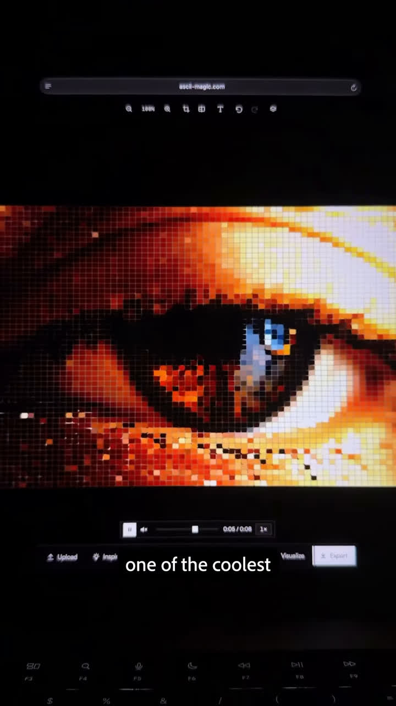
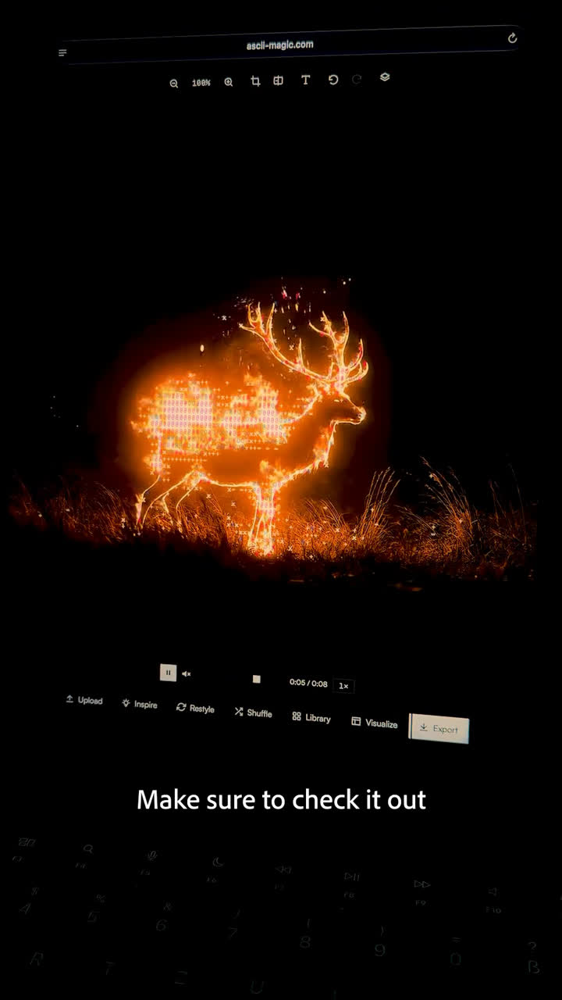

# ASCII Magic, a free shader editor for images and videos (timhosqo)

Source: [original reel](https://www.instagram.com/reel/Dfj6-Q0zGf3/) (Instagram video, @timhosqo, 22.5 seconds, posted 2026-11-10).

**Provenance.** Sent to the archive as a bare link on 2026-11-11 just after midnight JST. Recorded here: the caption (verbatim below), the site read from the browser bar in the frames, the UI buttons read from the frames, and the voiceover, fully transcribed from the extracted audio.

**Caption (verbatim).** "I found my favorite shader editor for my images and videos! You can customize and animate them!✌️🔥 #graphicdesign #designtools #uiuxdesigner #graphicdesigner #designtips"

**What it is.** Designer Tim Wingert demos [ascii-magic.com](https://ascii-magic.com) ("ASCII Magic - Free ASCII Art Generator, Image & Video to ASCII"), a browser shader editor: upload an image or video, apply animated shaders (ASCII/pixel-grid, hexagonal glass, RGB-glitch fragments and more shown), fine-tune each shader's settings, and export. The toolbar visible in the demo: **Upload, Inspire, Restyle, Shuffle, Library, Visualize, Export**. Demo footage includes an eye rendered as a colored ASCII grid, a hexagon-cell distortion over a garden photo, an RGB-split fragmented portrait, and a glowing ASCII-line stag in a field.

**Transcript (full, ~23 s).** "I found one of the coolest and most underrated shader editors that you need to check out if you're a creator. You can use it for free and you have a bunch of different shaders that you can use for your images or videos. There are also settings for each shader so that you can fine-tune everything. The website is called SC Magic and this is the link. Make sure to check it out and comment for more cool websites like this one." ("SC Magic" as transcribed; the browser bar in the video reads ascii-magic.com.)

339 likes and 14 comments at save (from video metadata, not independently checked). The site bills itself as free; no paid tier was checked.

## Items

#### 327. ASCII Magic - free in-browser shader editor for images and videos

[ascii-magic.com](https://ascii-magic.com) - upload an image or video, apply animated ASCII/pixel/glitch-style shaders, tune per-shader settings, and export the result. Free per the site and the reel. Sits next to r22's Figma shaders and r58's frontend-design tools as another visual-effect tool for the design stack; unlike those, it runs entirely in the browser on your own uploads, no code or plugin.

- [ASCII Magic](https://ascii-magic.com)
- [Instagram reel](https://www.instagram.com/reel/Dfj6-Q0zGf3/)
